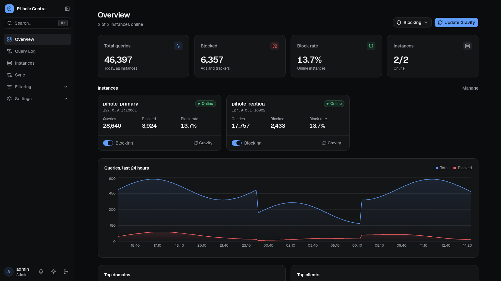

# Pi-Hole Central

A centralised dashboard for monitoring and managing multiple Pi-Hole v6 instances from a single interface.

> **Built entirely with [Claude Code](https://claude.ai/code)** — Anthropic's agentic coding tool.



---

## Quick Start

```bash
git clone https://github.com/PsycoStea/Pi-Hole-Central.git
cd Pi-Hole-Central
cp .env.example .env
```

Edit `.env` and fill in the required values (see [Environment Variables](#environment-variables) below), then:

```bash
docker compose up -d --build
```

Open **http://localhost:3100** in your browser.

> **Default credentials: `admin` / `admin`**
> Change the password immediately after the first sign-in via **Settings → Account**.

---

## Environment Variables

Copy `.env.example` to `.env` and set these values:

| Variable | Required | Description |
|---|---|---|
| `NEXTAUTH_SECRET` | ✅ | Random secret for JWT signing. Generate: `openssl rand -base64 32` |
| `ENCRYPTION_KEY` | ✅ | Key that encrypts the stored Pi-hole and SSH passwords. Generate: `openssl rand -base64 32`. **Never change it** once instances are saved |
| `NEXTAUTH_URL` | ✅ | Full URL where the dashboard is reached |
| `DATABASE_URL` | — | SQLite path; leave the default unless you change the volume mount |
| `SSH_KEY_PATH` | — | Host path of an SSH private key for the node features (recovery, watchdog, health checks, updates, Unbound, nebula-sync status). Mounted read-only |
| `SSH_KEY_PASSPHRASE` | — | Passphrase for that key, if it has one |
| `PIHOLE_CA_PATH` | — | Host path of the CA **certificate** (never the key) that signed your Pi-holes' https certificates. Needed only for `https://` node URLs |

**`NEXTAUTH_URL`**: set it to the address you use to open the dashboard: `http://localhost:3100` on the same machine, or e.g. `http://192.168.1.50:3100` from another one. Sign-in does not work if it is wrong.

**Behind an HTTPS reverse proxy** (e.g. Nginx Proxy Manager): set `NEXTAUTH_URL` to the public `https://` address, for example `https://piholecentral.example.com`. That makes the login cookies `Secure`, so the plain `http://<ip>:3100` address no longer signs in. Firewall port 3100 so that only the proxy can reach it: the app takes the client address for its sign-in rate limit and audit log from the proxy's `X-Real-IP` header. The live event stream sends `X-Accel-Buffering: no`, so nginx passes it through without extra config. Changing `NEXTAUTH_URL` or `NEXTAUTH_SECRET` signs everyone out.

Example `.env`:

```env
NEXTAUTH_SECRET=your-generated-secret-here
NEXTAUTH_URL=http://192.168.1.50:3100
ENCRYPTION_KEY=your-generated-key-here
DATABASE_URL=file:/app/data/pihole-central.db
```

### SSH access to the nodes (optional)

Recovery, the watchdog, health checks, Pi-hole updates and Unbound control run over SSH. Give the node user passwordless sudo for exactly these commands:

```bash
echo "pi ALL=(ALL) NOPASSWD: /bin/systemctl, /sbin/reboot, /usr/local/bin/pihole, /usr/sbin/unbound-control" | sudo tee /etc/sudoers.d/pihole-central
```

Host keys are pinned on first use; a changed key is refused and raises an alert.

### HTTPS to the Pi-holes (recommended)

Pi-hole v6 serves its API on 443. Give each node a certificate from your own small CA (with the node's IP address in the certificate), point `PIHOLE_CA_PATH` at the CA certificate, and add the instances as `https://<ip>`. The app then trusts **only** that CA for node traffic and never follows redirects, so the Pi-hole password and session never cross the network in clear. A daily check warns 30 days before a node certificate expires (Pi-hole never renews a certificate it did not issue itself).

---

## Features

### Overview Dashboard
- Aggregated stats across all instances: total queries, blocked queries, block rate, active clients
- Per-instance status cards with online/offline state, blocking toggle and key metrics
- Live updates via Server-Sent Events, with no page refresh
- Bulk enable/disable blocking and bulk gravity update across all instances
- Per-instance history up to 30 days (cached, so slow nodes stay responsive)

### Query Log
- Unified query log from all instances, searchable by domain or client, with paging

### Pi-hole configuration
- Domains (allow/deny, exact and regex), adlists, clients and groups, edited once and applied to the primary node
- DNS schedules and temporary allow rules that revert themselves
- Pi-hole updates started from the dashboard

### Backups
- Scheduled and manual Teleporter backups per instance, with retention and download
- Restore a backup to a node
- Optional webhook on backup success or failure

### Monitoring and automatic recovery (SSH)
- **Recovery:** when a node stops answering, the app checks on the node itself (its own API and DNS) before acting, restarts `pihole-FTL` if it is really down, and reboots only as a last resort (DNS also down, at most once a day per node). It never acts on two nodes at once, and stays off a node that is being updated, backed up or running gravity
- **Watchdog:** restarts FTL when leaked CLOSE-WAIT connections have broken its API, at most 3 times a day per node
- **Health checks:** SD-card/disk health, DNS latency, Unbound status and its DNS-over-TLS certificate expiry
- **nebula-sync:** container status and a drift check between the primary and replica nodes

### Notifications and alerts
- Channels: **Gotify**, **Pushover**, **Telegram** and **Email** (SMTP with enforced TLS), testable from Settings
- Alerts for instance offline/recovered, blocking disabled, low block rate, disk health, DoT certificate expiry, node HTTPS certificate, high latency, watchdog restarts, nebula-sync drift, Unbound down and changed SSH host keys
- In-app notification centre; conditions stay open until they clear, then resolve themselves

### Access Control
Two roles, enforced on the server:

| Feature | Admin | Viewer |
|---|---|---|
| Overview Dashboard | Read + control | Read only |
| Query Log | ✅ | ✅ |
| Instance detail pages | Read + control | Read only |
| Own account (password) | ✅ | ✅ |
| Everything else (blocking, gravity, configuration, instances, backups, notifications, alerts, settings, users, audit log) | ✅ | — |

### Audit log
- Every change (who, what, when, from which address) is recorded, including changes pushed to the nodes, with its own retention setting

---

## Security and hardening

Pi-Hole Central was built with an AI coding agent, so before this release it went through a structured security audit and fix pass instead of being taken on trust. The audit used the open-source [security-audit skill from Cloudflare](https://github.com/cloudflare/security-audit-skill), run by Claude Code agents under the maintainer's direction. It is not a third-party penetration test, but every finding had to be reproduced before it counted, and every fix had to be proven by a test. **The full list of findings and fixes is in [SECURITY-AUDIT.md](SECURITY-AUDIT.md).**

**The audit (November 2026).** Five scoped runs covered the codebase:

| Run | Scope |
|---|---|
| 1 | Unauthenticated surface, sign-in and sessions, viewer-to-admin authorization on every API route, the live event stream, users, audit log |
| 2 | SSH command construction and host keys, Pi-hole API path building, background jobs (poller, recovery, watchdog, DNS schedules) |
| 3A | Secrets at rest and in transit, SSRF and other outbound requests |
| 3B | Backups and restore, rendering, audit log, nebula-sync parsing |
| 4 | Build, deploy and supply chain |

Hunter agents looked for issues, independent verifier agents had to **reproduce each candidate** in an isolated lab (no network access, a read-only copy of the code, mock Pi-holes and SSH servers), and critic passes looked for areas the hunters missed.

**Result:** 42 records: 21 confirmed findings (2 Medium, 19 Low, none Critical or High), 15 leads that needed checking against a real deployment, and 6 rejected as not vulnerabilities. **All 36 confirmed findings and leads are fixed or hardened; none is open.**

**The fix pass.** Fixes shipped in phases, each deployed separately, each with:
- a **lab test that fails on the old code and passes on the new** (a test that passes either way proves nothing);
- a **live check** on the running deployment after release;
- and a **final regression run** over the released code: 275 lab assertions, 0 failures.

Some of what changed:
- **Sessions and sign-in:** sessions can be revoked (password change, admin reset, demotion and sign-out end every session); sign-in is rate-limited per address and per user; password hashing runs off the main thread so a login flood can't stall the app
- **Cross-site protection:** state-changing API calls and the live stream refuse cross-site requests; the dashboard can't be framed
- **Node traffic:** https to the Pi-hole nodes pinned to your own CA, no redirects followed, sessions bound to the URL that issued them, node certificate expiry alerts
- **Automatic recovery:** checks on the node itself before restarting or rebooting, never acts on two nodes at once, limits reboots, and keeps those limits across app restarts
- **Maintenance lock:** updates, gravity runs and backups take a per-node lock, so recovery can't interfere with them
- **Node load:** viewer-triggered node calls are cached, coalesced, cancelled when the browser disconnects, and capped per node; disabled nodes get no calls
- **Backups:** only a valid Teleporter archive counts as a backup; files are removed with their instance
- **Notifications:** webhook tokens don't follow redirects; email requires TLS
- **Supply chain:** Docker base image pinned by digest, owner-only data files, and a deploy script that only deploys an expected, fast-forward commit over an authenticated channel

**Known limits** (decided, not overlooked): stored secrets aren't bound to their database row (that needs a new ciphertext format); viewers can read some admin configuration through the API; your reverse proxy's traffic to *other* apps is out of scope.

**Reporting a vulnerability:** please use GitHub's private reporting (**Security → Report a vulnerability**) rather than a public issue.

---

## Stack

- **Framework**: Next.js 16 (App Router), TypeScript, React 19
- **Auth**: NextAuth.js v5 — Credentials provider, JWT sessions
- **Database**: SQLite via Drizzle ORM (better-sqlite3)
- **UI**: shadcn/ui, Tailwind CSS v4
- **Deployment**: Docker (multi-stage build, standalone output); `scripts/deploy.sh` is an optional build-then-swap deploy for a git checkout on the Docker host

### Database migrations: hand-written only

Migrations in `drizzle/migrations/` are written by hand. Only `meta/0000_snapshot.json`
exists, so **do not run `drizzle-kit generate`**: it would diff against the 0000 snapshot
and emit `CREATE TABLE` / `ADD COLUMN` for everything added since, the migrator would fail
with "already exists" inside its transaction, and the container would crash-loop on
start (and `scripts/deploy.sh` has already pruned the previous image by then).

To add one:
1. Write `drizzle/migrations/NNNN_name.sql`, separating statements with
   `--> statement-breakpoint`.
2. Append an entry to `meta/_journal.json` with the next `idx` and a `when` strictly
   greater than every previous entry (use the current time in ms). The migrator only
   applies entries whose `when` is newer than the last applied one — an equal or older
   value is skipped silently.
3. Update `src/lib/db/schema.ts` to match.
4. Test with the real migrator on a copy of the live DB *and* on a fresh empty DB before
   deploying.

---

## Pi-Hole Compatibility

Requires **Pi-Hole v6** — the v6 REST API is used for all data fetching and control operations.

---

## Built with Claude Code

This project was built entirely using [Claude Code](https://claude.ai/code), Anthropic's agentic coding tool. The full stack — from authentication and encrypted credential storage to the SSE live-data pipeline and role-based access control — was implemented through an iterative conversation with Claude without manually writing code.

---

## License

[MIT](LICENSE)
